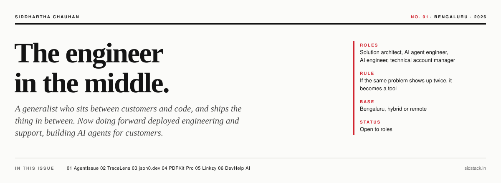
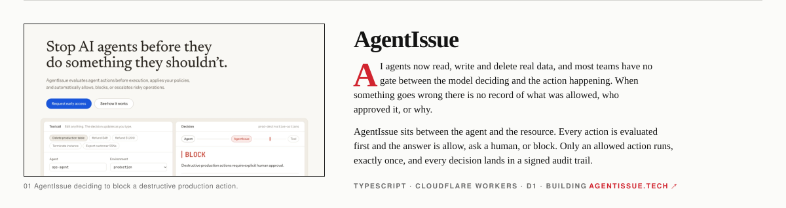
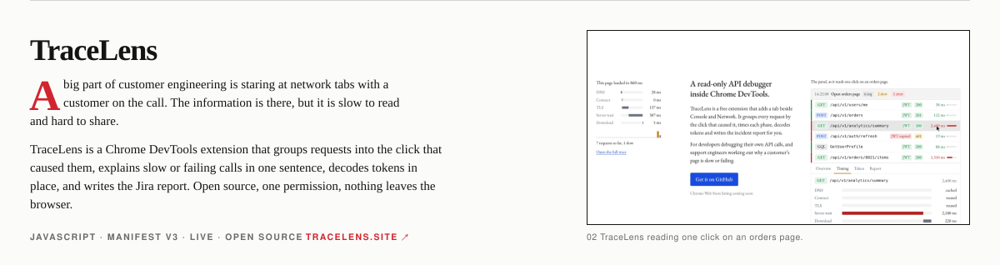
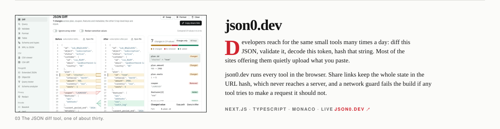
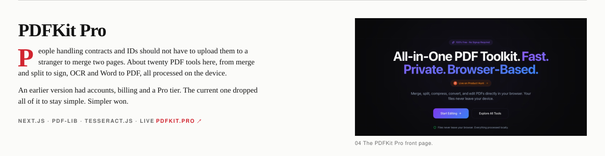
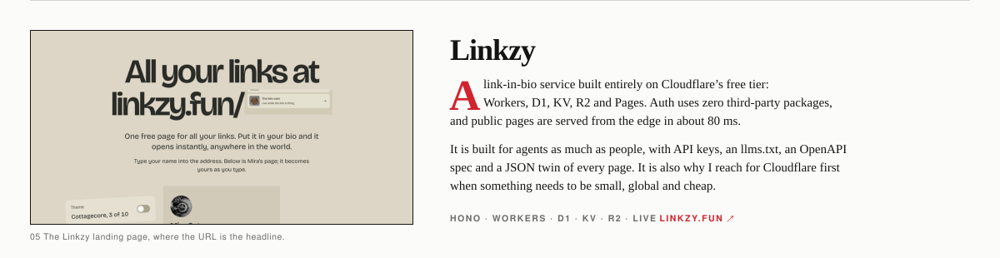
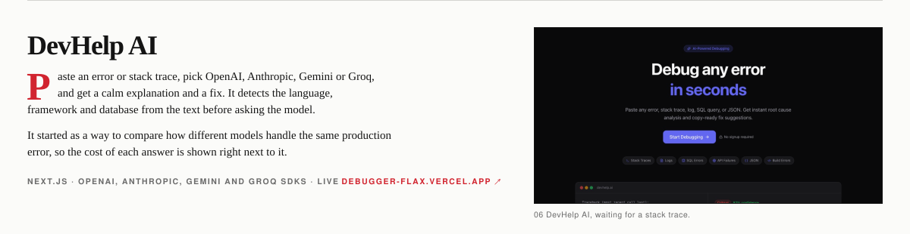

Source for the open ones: [TraceLens](https://github.com/Siddharthachuahan9/TRACELENS) · [json0.dev](https://github.com/Siddharthachuahan9/JSON0.dev) · [PDFKit Pro](https://github.com/Siddharthachuahan9/pdfpro) · [DevHelp AI](https://github.com/Siddharthachuahan9/DEBUGGER)

---

## Hi, I'm Siddhartha 👋

I'm a generalist engineer in Bengaluru who likes sitting right between customers and code. Someone tells me what's getting in their way, and I design the fix, build it, ship it, and stay around to make sure it keeps working. That last part is where most of the interesting problems live.

The roles that fit me best are **Solution Architect**, **AI Agent Engineer**, **AI Engineer** and **Technical Account Manager**. In practice I'm a bit of all four, usually in the same week.

Right now I do forward deployed engineering and support, building AI agents for customers who have real deadlines and very little patience for things that almost work. Before that, about three years as a Customer Engineer at [Hevo Data](https://hevodata.com), building integrations, AI agents and MCP servers.

## What I do

Mostly I connect things. One company's software to another's. An AI model to a set of tools it's allowed to use. A messy question from a customer to a clean answer they can act on.

The building blocks are AI agents, MCP servers, runtime guardrails, data integrations (ETL, CDC, reverse ETL, REST APIs), Cloudflare Workers, Next.js, Python, TypeScript and a lot of SQL. I lean toward boring tools, small surfaces, and planning for failure on day one, because something always fails and I'd rather have written down what happens next.

One habit shapes most of my work: **if the same problem shows up twice, it becomes a tool.** Everything on this page started that way.

## Smaller things that earned their keep

- **Hot Wheels Stock Tracker.** Quick-commerce apps restock collectibles at random. This watches Blinkit and Zepto for your pincode and sends a WhatsApp message the moment something comes back. Scheduling with jitter, circuit breakers, alert cooldowns, multi-tenant accounts. Yes, it started because I wanted one specific toy car.
- **Zendesk Bulk Ticket Console.** Load a list of customers from Google Sheets or CSV, validate it, confirm a hash so nothing changed, and create hundreds of tickets in one go. Support teams used to do this by hand. Now they don't.

## Work I can't link to, because customers own it

- **Matrix MCP server** at Hevo. Lets an AI model read and act inside chat rooms and internal systems from one conversation. Cut manual ops work by about 10%. The big lesson: how you design the tools matters more than which model you use.
- **AI handover-notes platform.** Drafts the full story of a customer case so the next engineer can pick it up cold. Handover prep went from about 20 minutes to about 5. The model is told to say "unknown" rather than guess.
- **Three years of customer connectors.** ETL, CDC, reverse ETL, REST APIs and databases, each shaped around one customer's auth, data model and environment. This is the work everything above grew out of.

## How I work

Understand → Design → Build → Deploy → Debug → Improve.

Get on a call. Ask what someone is trying to do, not just what broke, because the real problem is often two steps upstream. Write down the smallest fix in plain language and make sure they can explain it back to me. Ship it with a failure path already in place. Then something breaks anyway, and that's step five.

Longer version on my site: [sidstack.in](https://sidstack.in)

## Tools I reach for

`Python` `TypeScript` `SQL` `Next.js` `React` `Hono` `FastAPI` `Cloudflare Workers / D1 / KV / R2` `Supabase` `PostgreSQL` `MongoDB` `Snowflake` `BigQuery` `Redis / BullMQ` `MCP` `OpenAI / Anthropic / Gemini APIs` `Chrome Extensions` `Playwright`

## Say hi

- 🌐 [sidstack.in](https://sidstack.in)
- 💼 [LinkedIn](https://www.linkedin.com/in/siddharthachauhan)
- 📧 siddharthachauhan16@gmail.com

Open to Solution Architect, AI Agent Engineer, AI Engineer and Technical Account Manager roles. Bengaluru, hybrid or remote. Always happy to talk shop, or just talk.

The cover and feature spreads are plain SVG files generated by <code>scripts/build.mjs</code> from live screenshots. No tracking, no external services.
